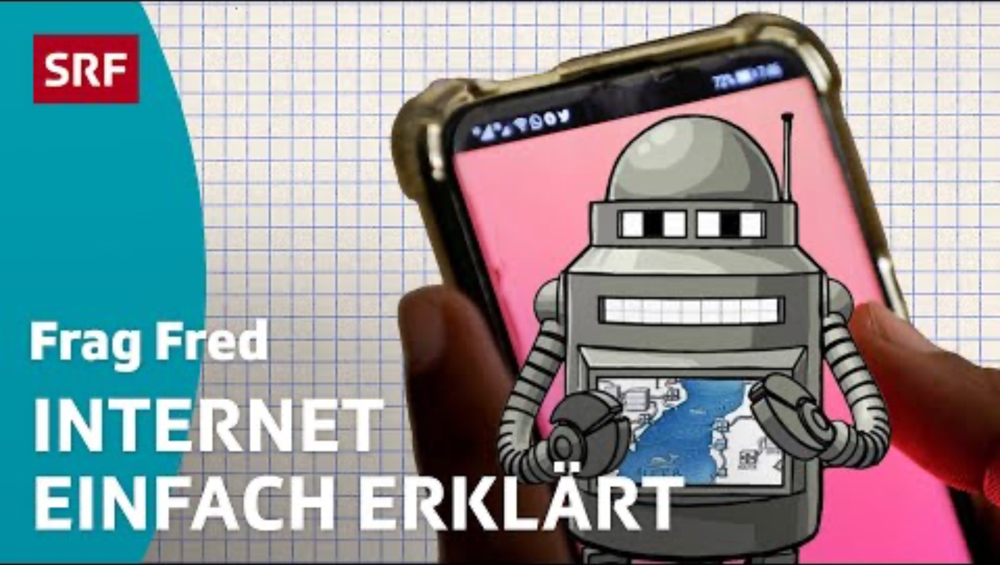
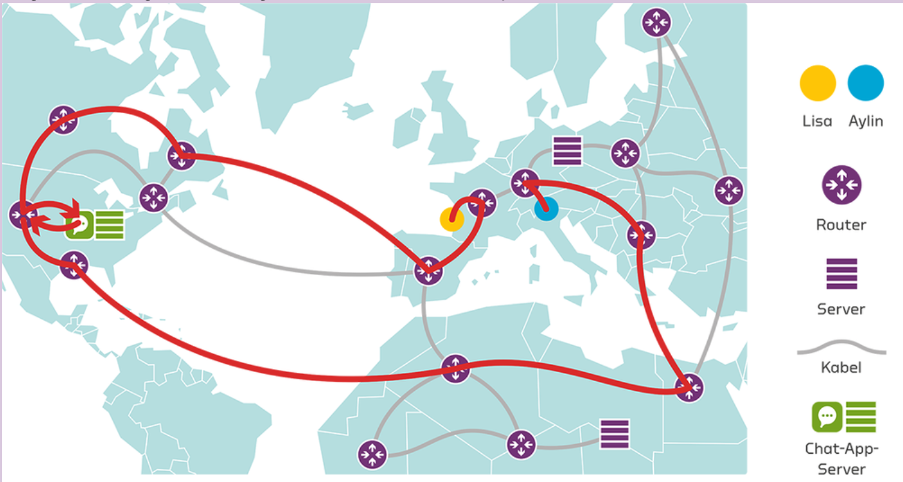

<!-- Erzeugt aus 02_MI_Praesentation_Kapitel1_Lektion1.pptx mit tools/pptx_zu_md.py, von Hand an das einheitliche Design angepasst. -->

<!-- .slide: class="titel" -->

# Ferien ohne Internet?

1\. Sekundarklasse · Kapitel 1A

***

Dienstag, 25. August 2026 · 11:05–11:50 Uhr

Note:
Ankommen und Begrüssung (ca. 3 Min). Kurz an letzte Woche anknüpfen: Wir haben uns kennengelernt. Heute startet Kapitel 1 «Eine Entdeckungsreise durch das Internet». Hinweis: Arbeitsbuch connected 3 bereitlegen.

---

## Ablauf der heutigen Lektion

| Phase | Worum es geht | Zeit |
|---|---|---|
| **Ankommen** | Rückblick auf letzte Woche, Start ins Kapitel 1 | 3 Min |
| **Meinungslinie** | Braucht es in den Ferien Internet? Wir beziehen Position | 10 Min |
| **Wie funktioniert das Internet?** | Erklärvideo und drei wichtige Begriffe | 12 Min |
| **Der Weg einer Nachricht** | Partnerarbeit: Wie kommt die Nachricht von Lisa zu Aylin? | 14 Min |
| **Sicherung und Ausblick** | Begriffe ins Glossar, Blick auf nächste Woche | 6 Min |

Note:
Nur kurz zeigen (ca. 1 Min), damit die Klasse den Ablauf kennt. Zeitangaben sind Richtwerte.

---

<!-- .slide: class="karten nummeriert" -->

## Das kannst du am Ende der Lektion

Diese drei Ziele nehmen wir uns heute vor.

### Position beziehen

Du kannst begründen, ob du in den Ferien Internet brauchst, und Argumente von anderen anhören.

### Begriffe erklären

Du kannst mit eigenen Worten erklären, was Router, Provider und Server machen.

### Weg beschreiben

Du kannst beschreiben, welchen Weg eine Chat-Nachricht durch das Internet nimmt.

> Lehrplan 21: MI.1.1.f · MI.2.3

Note:
Lernziele kurz vorlesen lassen (ca. 1 Min). Am Ende der Lektion nochmals darauf zurückkommen. Bezug Lehrplan 21: MI.1.1.f (Chancen und Risiken der Durchdringung des Alltags) sowie MI.2.3 (Aufbau und Funktionsweise informationsverarbeitender Systeme).

---

<!-- .slide: class="ziele" -->

## Euer Lehrmittel

Ab heute arbeitet ihr mit «connected 3», Medien und Informatik.

1. Schreibe deinen Namen vorne ins Buch.
2. Bring das Buch jede Woche in den M&I-Unterricht mit.
3. Behandle es sorgfältig, du brauchst es das ganze Jahr.
4. Schlag heute Kapitel 1 auf: «Eine Entdeckungsreise durch das Internet».

---

<!-- .slide: class="frage" data-zeit="10" -->

## Ferien ohne Internet: Albtraum oder Erholung?

- Stell dich auf die Linie im Klassenzimmer: links «geht gar nicht», rechts «kein Problem».
- Überlege dir einen Grund für deinen Standort.
- Wir hören einige Begründungen an. Du darfst deinen Platz danach wechseln.

Note:
Aufgabe 101 (ca. 10 Min). Meinungslinie quer durch das Zimmer. Erst Position einnehmen lassen, dann 4 bis 6 Lernende begründen lassen, dabei bewusst beide Enden der Linie ansprechen. Kontroverse Diskussion ist erwünscht und darf Raum bekommen (vgl. Handbuch connected 3, Aufgabe 101). Wichtig: keine Bewertung richtig/falsch, es geht um Argumente.

---

<!-- .slide: class="karten" -->

## Eure Argumente im Überblick

Beide Seiten haben gute Gründe, es gibt kein Richtig oder Falsch.

### Ohne Internet ist es besser

- Ich kann besser abschalten und bin ganz vor Ort.
- Ich verbringe mehr Zeit mit der Familie.
- Ich stehe nicht unter Druck, ständig etwas zu posten.
- Ich lerne eher neue Leute am Ferienort kennen.

### Internet gehört dazu

- Ich bleibe mit Kolleginnen und Kollegen in Kontakt.
- Musik, Videos und Spiele funktionieren nur online.
- Karten, Fahrpläne und Öffnungszeiten finde ich sofort.
- Wichtige Nachrichten von zu Hause kommen an.

Note:
Sicherung der Meinungslinie (ca. 3 Min). Erst die Argumente der Klasse sammeln, dann diese Folie als Ergänzung zeigen. Argumente stammen aus dem Handbuch connected 3 zu Aufgabe 101. Überleitung: «Ihr nutzt das Internet täglich, aber wie kommt eine Nachricht eigentlich ans Ziel?»

---

<!-- .slide: class="karten" -->

## Wie funktioniert das Internet?

Wir schauen ein Erklärvideo, ihr notiert dabei drei Begriffe.

### Auftrag während des Videos <!-- .element: class="hervor" -->

- Schlage im Arbeitsbuch die Aufgabe 102 auf.
- Notiere in Stichworten, was Router, Provider und Server machen.
- Notiere ein Wort, das du nicht verstanden hast.

### Danach

Vergleiche deine Notizen kurz mit deinem Banknachbarn oder deiner Banknachbarin.

Note:
Ca. 6 Min. Erklärvideo zum Aufbau des Internets über Beamer zeigen (Erklärvideo der connected-Webplattform oder ein gleichwertiges Video vorgängig prüfen). Das Video erleichtert den Einstieg in die anspruchsvolle Infrastruktur-Thematik (vgl. Handbuch, Aufgabe 102). Danach 2 Min Austausch zu zweit.

---

<!-- .slide: class="spalten" -->

## Wie funktioniert das Internet?

***

**Achte beim Schauen auf:**

- Router
- Provider
- Server

*Diese drei Begriffe brauchst du gleich für die Aufgabe 102.*

Note:
Video vorgängig auf dieser Folie einbetten oder verlinken. Vor dem Abspielen die drei Begriffe ankündigen, damit die SuS gezielt zuhören.

---

<!-- .slide: class="auftrag" -->

## Die drei Bausteine

- Zeit: 5 Minuten
- Sozialform: Einzelarbeit
- Arbeitsbuch: Aufgabe 102

1. Nimm das Lehrmittel und suche Aufgabe 102.
2. Schreibe in eigenen Worten auf: Was macht ein Router? Was macht ein Provider? Was macht ein Server?
3. Schreibe zu jedem Begriff mindestens einen ganzen Satz.

> Tipp: Denk an das Video. Du musst nicht die perfekte Definition treffen, deine eigene Erklärung zählt.

---

<!-- .slide: class="karten" -->

## Drei Bausteine des Internets

Diese drei Begriffe brauchst du im ganzen Kapitel.

### Router

Router leiten Daten weiter, von einem Netzwerk ins nächste. Sie sind die Kreuzungen im Internet.

### Provider

Provider sind Firmen, die dir den Zugang zum Internet verkaufen, zum Beispiel Swisscom oder Sunrise.

### Server

Server sind Computer mit einer festen Aufgabe. Sie sind rund um die Uhr online und liefern zum Beispiel Webseiten.

> Merke: «to provide» heisst liefern, «to serve» heisst dienen.

Note:
Ca. 4 Min. Begriffe gemeinsam klären, dabei die Notizen der Klasse aufgreifen. Definitionen gemäss Handbuch connected 3 (Aufgabe 102). Aufgabe 103: Die Lernenden vergleichen ihre Antworten mit dem Glossar auf der Webplattform und notieren dort eine eigene Erklärung plus ein Stichwort zum Kontext.

---

<!-- .slide: class="auftrag" -->

## Der Weg einer Nachricht

- Zeit: 10 Minuten
- Sozialform: Partnerarbeit
- Arbeitsbuch: Aufgabe 104

1. Lisa schreibt aus den Ferien eine Nachricht an Aylin in der Schweiz.
2. Zeichnet zu zweit ein, welchen Weg die Nachricht nimmt.
3. Verwendet dabei die Begriffe Router, Provider und Server.
4. Haltet fest: Nimmt die Antwort denselben Weg zurück?

Note:
Ca. 10 Min Partnerarbeit (Aufgabe 104). Herumgehen und unterstützen. Hilfsfragen für schwächere Paare: Womit verbindet sich das Handy zuerst? Wer bringt die Daten aus dem Hotel hinaus? Wo liegt die Nachricht zwischendurch? Schnelle Paare: Was passiert, wenn ein Router unterwegs ausfällt?

---

<!-- .slide: class="karten nummeriert" -->

## So reist die Nachricht

Vom Smartphone über Provider, Router und Kabel zum Server und zurück.

### Lisas Smartphone

### Netz des Providers

### Viele Router und Kabel

### Server der Chat-App

***

**Rückweg:** vom Server über Router und Kabel und das Netz des Providers zu Aylins Smartphone.

> Wichtig: Der Rückweg muss nicht derselbe sein wie der Hinweg. Das Internet sucht sich jedes Mal einen freien Weg.

Note:
Ca. 4 Min Besprechung. Zuerst zwei Paare ihre Lösung erklären lassen, erst danach diese Folie einblenden. Musterlösung gemäss Handbuch, Aufgabe 104: Die Daten gehen vom Smartphone ins Netz des Providers, über verschiedene Router und Kabel zum Server der Chat-App und von dort zurück zu Aylin. Der Rückweg muss nicht derselbe sein.

---

## Schon fertig?

*Zusatzaufgabe für Schnelle*

**Was passiert wohl, wenn irgendwo auf der Welt ein Unterseekabel beschädigt wird?**

Bricht dann das ganze Internet zusammen? Schreibe deine Vermutung auf und begründe sie in zwei Sätzen.

> Es gibt hier keine falsche Antwort. Wichtig ist deine Begründung.

---

<!-- .slide: class="auftrag" -->

## Der Weg der Nachricht (Aufgabe 104)

- Auftrag: 2
- Zeit: 12 Minuten
- Sozialform: Partnerarbeit
- Arbeitsbuch: Aufgabe 104

Note:
Kernaufgabe der Lektion (Handbuch, Aufgabe 104). Beobachtungsbogen nutzen: Wer verwendet alle drei Begriffe korrekt?

---

<!-- .slide: class="spalten" -->

## Das nimmst du heute mit

Trage die drei Begriffe in dein Glossar ein.

- **Router:** leitet Daten weiter
- **Provider:** liefert den Zugang
- **Server:** dient und liefert Inhalte

***

### Auftrag zum Schluss

- Schreibe zu jedem Begriff eine eigene Erklärung ins Glossar.
- Notiere dazu ein Stichwort, wo du den Begriff gebraucht hast.

Note:
Ca. 4 Min. Aufgabe 103: Eigene Erklärung und ein Kontext-Stichwort im Glossar festhalten. Falls die Zeit knapp wird, als Hausaufgabe auf nächste Woche mitgeben. Kurzer Rückbezug auf die drei Lernziele von Folie 3.

---

<!-- .slide: class="frage" -->

## Nächste Woche

- Ihr erhaltet euren eigenen Microsoft-Account.
- Wir loggen uns gemeinsam in Microsoft Teams ein.
- Wir schauen uns Kanäle und Chat an.

*Bring dein Arbeitsbuch wieder mit.*

Note:
Ca. 2 Min Ausblick. Hinweis: Prüfen, ob die Microsoft-Accounts bis dann tatsächlich bereit sind, sonst diese Folie anpassen.

---

<!-- .slide: class="frage" -->

## Danke für heute!

Bis nächste Woche, Dienstag 11:05 Uhr

Note:
Verabschiedung, offene Fragen klären, Material einsammeln.
