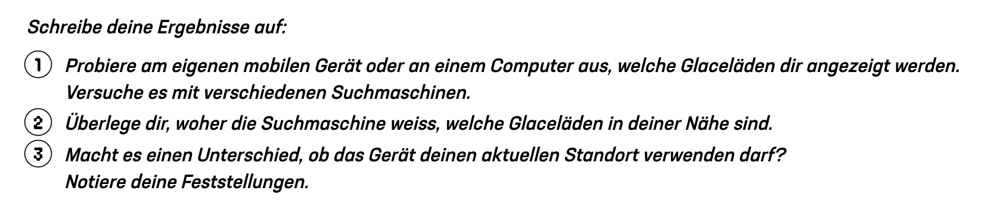

<!-- Erzeugt aus 02_MI_Praesentation_Kapitel1_Lektion2_IP-Adresse_und_Standort.pptx mit tools/pptx_zu_md.py. Anleitung zum Bearbeiten: README.md -->

<!-- .slide: class="titel" data-nummer="2" -->

# Wo gibt es die beste Glace?

Wie Webseiten wissen, wo du gerade bist

***

connected 3, Kapitel 1B, Dienstag 15.09.2026

Note:
Einstieg ohne lange Vorrede. Die Klasse soll zuerst selbst suchen, erst danach wird erklärt.

---

<!-- .slide: class="ziele" -->

## Das lernst du heute

1. Ich kann erklären, was eine IP-Adresse ist und wozu sie gebraucht wird.
2. Ich kann vier Arten der Standortbestimmung nennen und nach Genauigkeit ordnen.
3. Ich kann an zwei Beispielen erklären, welche Folgen es hat, dass Webseiten meinen Standort kennen.

Note:
Lernziele kurz vorlesen lassen, nicht kommentieren. Am Schluss der Lektion zurückkommen.

---

<!-- .slide: class="frage" data-zeit="5" -->

## Sucht jetzt nach: Glace

Gebt keinen Ortsnamen ein. Notiert eure ersten drei Treffer im Arbeitsbuch bei Aufgabe 105

Note:
Alle suchen gleichzeitig. Danach vergleichen: Alle sehen Läden aus der Umgebung.

---

<!-- .slide: class="frage" data-zeit="5" -->

## Sucht jetzt nach: Glace

Note:
Alle suchen gleichzeitig. Danach vergleichen: Alle sehen Läden aus der Umgebung.

---

<!-- .slide: class="frage" -->

## Woher weiss die Suchmaschine, wo wir sind?

Sammelt eure Vermutungen. Es gibt mehr als eine richtige Antwort.

Note:
Häufigste Vermutung: GPS. Diese Vermutung stehen lassen und mit der Gegenprobe prüfen.

---

<!-- .slide: class="karten nummeriert" -->

## Die Gegenprobe

### Standort aus

Schaltet die Standortfreigabe im Gerät aus.

### Nochmals suchen

Gebt denselben Suchbegriff erneut ein.

### Und jetzt? <!-- .element: class="hervor" -->

Die Treffer aus der Umgebung erscheinen trotzdem. Also kann es nicht nur an GPS liegen.

Note:
Dieser Moment ist der Kern der Lektion. Erst jetzt den Begriff IP-Adresse einführen.

---

<!-- .slide: class="merke" -->

## Jedes Gerät im Internet hat eine IP-Adresse.

Sie funktioniert wie die Adresse auf einem Paket. Ohne sie wüssten die Router nicht, wohin die Daten sollen. Aus der IP-Adresse lässt sich der ungefähre Standort ablesen: Land, Region, oft die Stadt.

Note:
Analogie Paketadresse verwenden. Betonen: ungefähr, nicht die Wohnadresse.

---

<!-- .slide: class="karten" -->

## Zwei Adressen, ein Gerät

### Lokale IP-Adresse

- Gilt nur im eigenen Netz, zum Beispiel im Schulhaus
- Beginnt oft mit 192.168.
- Von aussen nicht sichtbar
- Wird vom Router vergeben

### Öffentliche IP-Adresse

- Die Adresse, die Webseiten sehen
- Gehört dem Router, nicht dem einzelnen Gerät
- Alle Geräte im Schulnetz teilen sie
- Verrät den ungefähren Standort

Note:
Erklärt, warum alle in der Klasse dieselbe öffentliche IP-Adresse sehen.

---

<!-- .slide: class="karten" -->

## Vier Wege zum Standort

### IP-Adresse

Genauigkeit: Region oder Stadt. Immer vorhanden, sobald du online bist.

### GPS

Genauigkeit: wenige Meter. Nur mit deiner Erlaubnis.

### Mobilfunk

Genauigkeit: Funkzelle. Mit mehreren Antennen recht genau.

### WLAN

Genauigkeit: wenige hundert Meter. Über bekannte Basisstationen.

Note:
Reihenfolge nach Genauigkeit ordnen lassen: GPS, Mobilfunk mit mehreren Antennen, WLAN, IP-Adresse.

---

<!-- .slide: class="auftrag" -->

## Forscherauftrag: Wo steht der Server?

- Auftrag: 1
- Zeit: 10 Minuten
- Sozialform: Partnerarbeit
- Arbeitsbuch: Aufgabe 106

1. Öffnet einen IP-Abfragedienst, zum Beispiel wieistmeineip.ch.
2. Tragt eure öffentliche IP-Adresse und den angezeigten Ort in die Tabelle ein.
3. Sucht die IP-Adressen und Standorte von srf.ch, sbb.ch und youtube.com.
4. Vergleicht eure IP-Adresse mit der eurer Banknachbarin oder eures Banknachbarn.

Note:
Keine IP-Adressen an die Wand projizieren und nicht in Teams posten. Wer schnell ist: Warum zeigt www.srf.ch einen anderen Standort als srf.ch?

---

<!-- .slide: class="auftrag" -->

## Was hat die IP-Adresse damit zu tun?

- Auftrag: 2
- Zeit: 8 Minuten
- Sozialform: Gruppenarbeit
- Arbeitsbuch: Aufgabe 107

1. Lest die drei Situationen auf AB 1.
2. Erklärt je in einem Satz, was die IP-Adresse damit zu tun hat.
3. Einigt euch in der Gruppe auf die beste Formulierung.

Note:
Situationen: gesperrtes Video, Währung im Onlineshop, Werbung aus der Region.

---

<!-- .slide: class="loesung" -->

## Auflösung

- Gesperrtes Video: Die Plattform liest am Standort der IP-Adresse das Land ab und prüft, ob sie das Video dort zeigen darf.
- Währung im Shop: Der Shop erkennt das Land und stellt die passende Währung ein.
- Passende Werbung: Suchanfragen werden zusammen mit der IP-Adresse gespeichert, daraus entstehen Profile.
- Zusatz: Staaten können mit Hilfe der IP-Adressen ganze Dienste landesweit sperren.

> Wichtig: Die IP-Adresse zeigt einen ungefähren Ort, nicht eure Wohnadresse.

Note:
Kurz halten, die Beispiele stammen aus der Klasse.

---

<!-- .slide: class="karten" -->

## Die fünf Begriffe aus Kapitel 1A, kurz aufgefrischt

### Server

Computer, der rund um die Uhr online ist und Inhalte liefert.

### Router

Leitet Datenpakete von einem Netzwerk ins nächste.

### Provider

Firma, die den Zugang zum Internet bereitstellt.

### IP-Adresse

Adresse, unter der ein Gerät im Internet erreichbar ist.

### Glasfaserkabel

Leitung, durch die sehr grosse Datenmengen sehr schnell fliessen.

Note:
Diese fünf Begriffe kommen in der Prüfung als Zuordnungsaufgabe vor. Kurz abfragen, nicht neu erklären.

---

<!-- .slide: class="frage" data-zeit="5" -->

## Bin ich im Internet anonym?

Schreibe deine Antwort in einem Satz mit Begründung ins Heft. Das ist dein Exit-Ticket.

Note:
Antworten einsammeln oder zwei vorlesen lassen. Überleitung auf die nächste Lektion.

---

<!-- .slide: class="karten untereinander" -->

## Zum Schluss

### Hausaufgabe

Prüfe zu Hause, welche drei Apps deinen Standort verlangen. Notiere, ob der Standort dafür wirklich nötig ist.

### Nächstes Mal

Nächste Woche: Kann man Online-Bewertungen trauen? Und warum ruckelt ein Video manchmal?
