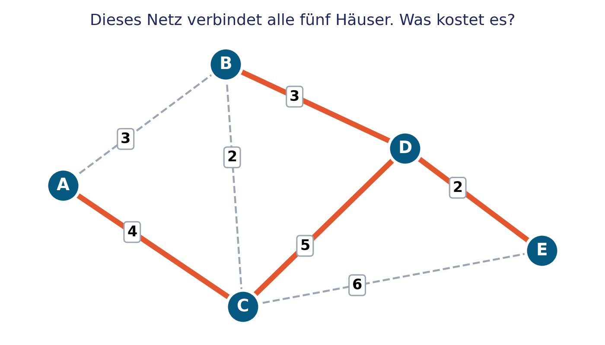
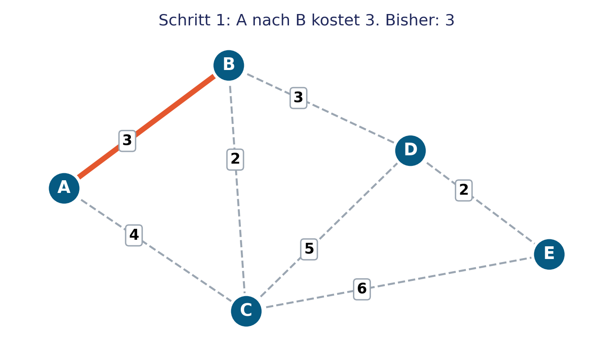
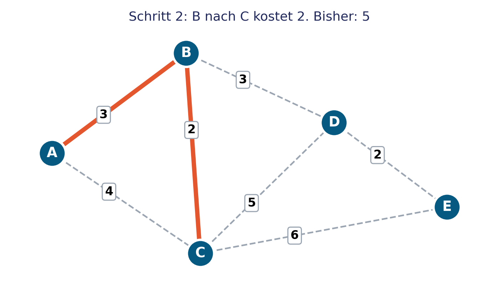
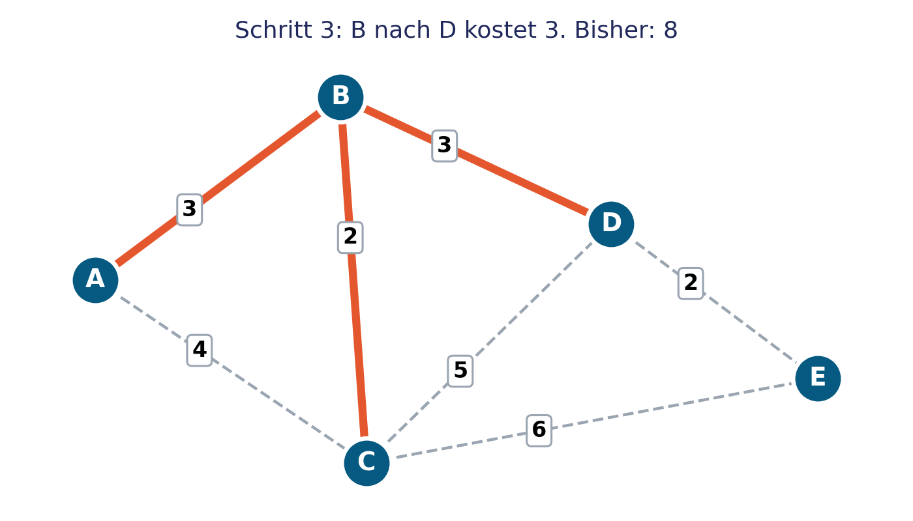
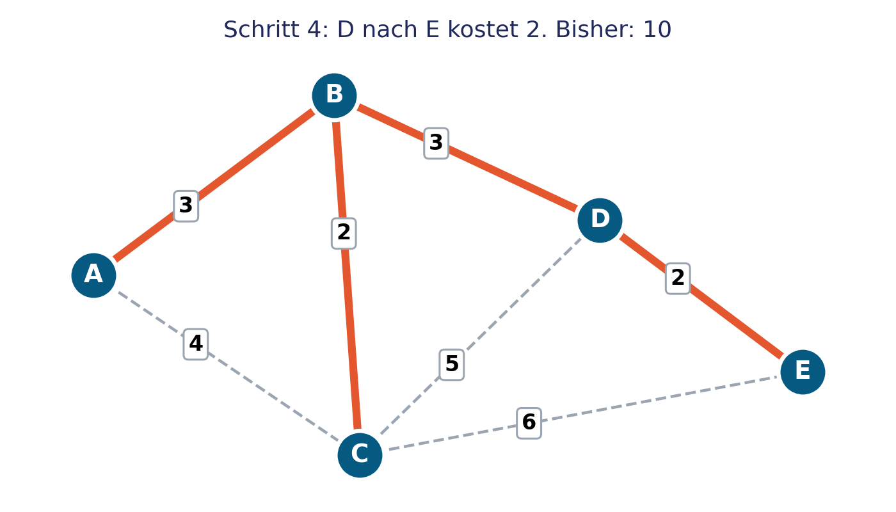

<!-- Erzeugt aus MI_K1_L5_NiveauB_Netzwerke_planen_Prim.pptx mit tools/pptx_zu_md.py. Anleitung zum Bearbeiten: README.md -->

<!-- .slide: class="titel" data-nummer="3" -->

# Netzwerke planen

Das Verfahren von Prim

***

connected 3, Kapitel 1E, Niveau B

Note:
Heute wird viel gezeichnet. Merkkarten und Farbstifte bereitlegen.

---

<!-- .slide: class="ziele" -->

## Das lernst du heute

1. Ich kann die Kosten eines Netzes ausrechnen.
2. Ich kann mit dem Verfahren von Prim das günstigste Netz einzeichnen.
3. Ich weiss: Bei 5 Punkten braucht es 4 Verbindungen.

---

<!-- .slide: data-zeit="4" -->

## Fünf Häuser sollen Internet bekommen

Zähl die Kosten zusammen. Wie teuer ist dieses Netz?

Note:
Lösung: 4 plus 5 plus 3 plus 2 gleich 14.

---

<!-- .slide: class="frage" data-zeit="5" -->

## Geht es auch günstiger?

Probiert es kurz auf AB 3 B. Alle Häuser müssen verbunden sein.

Note:
Nur kurz probieren lassen. Es geht darum zu merken: Probieren ist unsicher.

---

## Das Verfahren von Prim

- Wähle einen Startpunkt.
- Suche die günstigste Verbindung zu einem Haus, das noch nicht angeschlossen ist. Zeichne sie ein.
- Wiederhole Schritt 2, bis alle Häuser dran sind.
- Verbinde nie zwei Häuser, die beide schon am Netz hängen.

> Kontrolle: 5 Häuser brauchen 4 Verbindungen.

Note:
Die Merkkarte mit denselben vier Schritten liegt auf jedem Tisch.

---

## Wir machen es zusammen, Start bei A

Note:
Zuerst fragen: Welche Verbindung ist jetzt die günstigste? Erst dann einblenden.

---

## Wir machen es zusammen, Start bei A

Note:
Zuerst fragen: Welche Verbindung ist jetzt die günstigste? Erst dann einblenden.

---

## Wir machen es zusammen, Start bei A

Note:
Zuerst fragen: Welche Verbindung ist jetzt die günstigste? Erst dann einblenden.

---

## Wir machen es zusammen, Start bei A

Note:
Fertig: vier Verbindungen, Kosten 10. Kontrollregel anwenden lassen.

---

<!-- .slide: class="auftrag" -->

## Jetzt du: dasselbe Netz, Start bei E

- Auftrag: 1
- Zeit: 8 Minuten
- Sozialform: allein, Kontrolle zu zweit
- Material: AB 3 B, Merkkarte
- Arbeitsbuch: wie Aufgabe 119

1. Nimm die Merkkarte und arbeite Schritt für Schritt.
2. Trage jeden Schritt in die Tabelle ein.
3. Kreuze an: Kommt dasselbe Netz heraus?

---

<!-- .slide: class="merke" -->

## Der Startpunkt ist egal. Das günstigste Netz bleibt gleich.

Das Verfahren funktioniert immer. Solche klaren Schritte nennt man einen Algorithmus. Im Januar schreiben wir Algorithmen selbst, in Scratch.

---

<!-- .slide: class="auftrag" -->

## Grösseres Netz mit sechs Häusern

- Auftrag: 2
- Zeit: 8 Minuten
- Sozialform: allein oder mit der Lehrperson
- Material: AB 3 B
- Arbeitsbuch: wie Aufgabe 118

1. Starte bei A und arbeite mit der Merkkarte.
2. Rechne die Gesamtkosten aus.
3. Kontrolliere: 6 Häuser brauchen 5 Verbindungen.

Note:
Wer Hilfe braucht, arbeitet mit der Lehrperson an der Wandtafel weiter. Wer fertig ist: Arbeitsbuch 118 bis 120.

---

<!-- .slide: class="ziele" -->

## Das haben wir heute gelernt

1. Ich kann die Kosten eines Netzes ausrechnen.
2. Ich kann mit dem Verfahren von Prim das günstigste Netz einzeichnen.
3. Ich weiss: Bei 5 Punkten braucht es 4 Verbindungen.

Note:
Am Schluss der Lektion nochmals zeigen und abhaken lassen.

---

<!-- .slide: class="karten untereinander" -->

## Zum Schluss

### Hausaufgabe

Keine. Wer mag, zeichnet zu Hause ein eigenes Netz mit höchstens acht Häusern.

### Nächstes Mal

Nach den Ferien: Was ist der Unterschied zwischen Internet und WWW?
