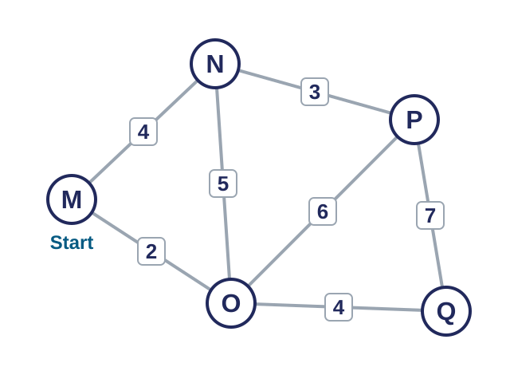
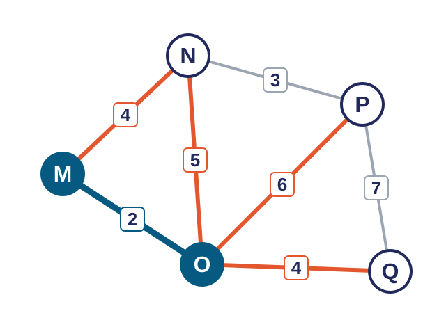
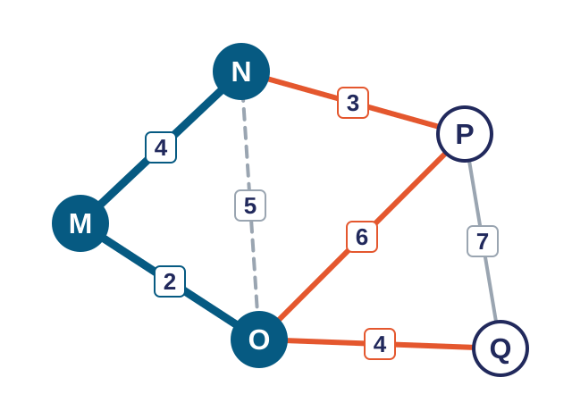
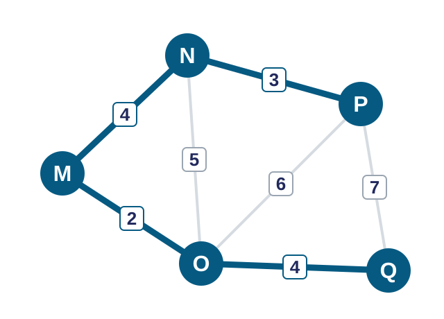

<!-- Erzeugt aus MI_Kapitel_1_Ru_ckblick_und_Prim_20.10.2026.pptx, von Hand an das einheitliche Design angepasst. -->

<!-- .slide: class="titel" -->

# Eine Entdeckungsreise durch das Internet

Zwischenrückblick und Algorithmus von Prim

***

Medien und Informatik · 1. Sek · Di 20.10.2026 · Prüfung 1 am Dienstag, 10.11.2026

Note:
Ankommen, ca. 2 Minuten. Begrüssen, kurz sagen, was heute läuft: ein Blick zurück auf die Reise nach den Herbstferien, danach wird Prim abgeschlossen. Hinweis für dich: Bis zur Prüfung am 10.11. bleiben nur noch drei Dienstage (20.10., 27.10., 03.11.). Darum ist der Stoff von 1F bis 1I auf zwei Lektionen verdichtet.

---

## Ablauf der Lektion

| Phase | Worum es geht | Zeit |
|---|---|---|
| **Rückblick** | Unsere Reise durch Kapitel 1 bis jetzt | 5 Min |
| **Gimkit** | Quiz zu den Stationen 1A bis 1E | 8 Min |
| **Prim wiederholen** | Die vier Schritte an einem neuen Beispiel | 10 Min |
| **Auftrag** | Arbeitsbuch Aufgaben 118 bis 120, zu zweit | 17 Min |
| **Sicherung** | Was merken wir uns? Ausblick auf die Prüfung | 5 Min |

Note:
Zeitangaben sind Richtwerte und ergeben 45 Minuten. Nur kurz zeigen (ca. 1 Minute). Die Auftragsphase ist mit 17 Minuten der grösste Block, damit alle Prim selbst anwenden können.

---

<!-- .slide: class="karten kompakt" data-spalten="3" data-zeit="5" -->

## Unsere Reise durch Kapitel 1

### Ferien ohne Internet

1A · erledigt

### Wo gibt es die beste Glace?

1B · erledigt

### Traust du Online-Bewertungen?

1C · erledigt

### Datenstau im Netz

1D · erledigt

### Netzwerke planen <!-- .element: class="hervor" -->

1E · wir sind hier

### Der Post ist da <!-- .element: class="offen" -->

1F · Di 27.10.

### Tolle Fotos, tolle Ferien? <!-- .element: class="offen" -->

1G · Di 27.10.

### Aufmerksamkeit um jeden Preis <!-- .element: class="offen" -->

1H · Di 03.11.

### Reisetagebuch <!-- .element: class="offen" -->

1I · Di 03.11.

Note:
5 Minuten. Station für Station mündlich durchgehen: Was war jeweils das Wichtigste? Pro Station nennt jemand ein Stichwort (zum Beispiel 1A: Router, Provider, Server; 1B: IP-Adresse verrät den ungefähren Standort; 1C: Kriterien für Bewertungen; 1D: letzte Meile und Datenstau). Zum Schluss auf die gestrichelten Stationen zeigen: Diese kommen in den nächsten zwei Lektionen. Danach folgt die Prüfung am 10.11.

---

<!-- .slide: class="auftrag" -->

## Gimkit: Weisst du's noch?

- Zeit: 8 Minuten
- Sozialform: allein
- Material: iPad

1. Öffne **gimkit.com/join**.
2. Gib den Spielcode ein, den ich euch zeige, und deinen Vornamen.
3. Beantworte die Fragen zu den Stationen 1A bis 1E: Router, IP-Adresse, Bewertungen, Datenstau und Prim.

> Danach schauen wir gemeinsam an, was gut sass und was nochmals wichtig ist.

Note:
Gimkit statt der fünf Fragen im Partnergespräch. Vorgehen: Spiel auf gimkit.com starten (Live-Spiel, Modus zum Beispiel «Classic»), Spielcode am Beamer zeigen, ca. 6 Minuten spielen lassen, dann 2 Minuten Rückmeldung: Welche Fragen waren schwierig? Ohne Hilfsmittel, damit sichtbar wird, was sitzt. Die Zusammenfassung steht auf der nächsten Folie.

Fragen für das Kit (aus der bisherigen Folie, mit Antworten):
1. Was macht ein Router? Antwort: Er leitet Datenpakete von einem Netzwerk ins nächste weiter.
2. Was verrät deine IP-Adresse über dich? Antwort: den ungefähren Standort des Geräts, nicht die genaue Adresse.
3. Nenne ein Kriterium für eine glaubwürdige Online-Bewertung. Antwort: zum Beispiel mindestens 20 Bewertungen, Textkommentar, persönliche Erfahrung, über längere Zeit verteilt, aktuell.
4. Nenne einen Grund für Datenstau im Netz. Antwort: zum Beispiel zu viele Personen im gleichen WLAN (letzte Meile), grosse Videodaten, viele Router auf dem Weg.
5. Was will der Algorithmus von Prim erreichen? Antwort: alle Dörfer verbinden, und zwar mit möglichst geringen Gesamtkosten.

Die Fragen decken Prüfungsaufgabe 1 (Begriffe), 4 (Standort), 6 (Bewertungen) und 5 (Prim) ab.

---

<!-- .slide: class="loesung ziele kompakt" -->

## Das haben wir gelernt

1. **Router:** leitet Datenpakete von einem Netzwerk ins nächste weiter.
2. **IP-Adresse:** den ungefähren Standort des Geräts, nicht die genaue Adresse.
3. **Bewertungen:** zum Beispiel mindestens 20 Bewertungen, Textkommentar, persönliche Erfahrung, über längere Zeit verteilt, aktuell.
4. **Datenstau:** zum Beispiel zu viele Personen im gleichen WLAN (letzte Meile), grosse Videodaten, viele Router auf dem Weg.
5. **Prim:** alle Dörfer verbinden, und zwar mit möglichst geringen Gesamtkosten.

Note:
Zusammenfassung nach dem Gimkit. Mehrere Antworten sind möglich, jede sinnvolle Antwort gilt. Zur IP-Adresse: In der Prüfung (Aufgabe 4) sollen auch zwei weitere Ortungsarten genannt werden. Mögliche Ergänzung im Plenum: Satelliten (GPS), Mobilfunk, WLAN-Basisstationen. Zum Datenstau: Das Nadelöhr ist die letzte Meile (Router zu den Haushalten), nicht die Länge der Glasfaserkabel. Bei Unsicherheit das Thema kurz nochmals an der Karte (Folie «Unsere Reise») verorten.

---

<!-- .slide: class="karten nummeriert" data-zeit="10" -->

## So findet man das günstigste Netz

### Start

Wähle ein beliebiges Dorf als Start.

### Prüfen

Schau alle Verbindungen an, die vom Netz zu einem noch nicht angeschlossenen Dorf führen.

### Wählen

Nimm die günstigste davon. Bei Gleichstand ist beides richtig.

### Wiederholen

Mache weiter bei Schritt 2, bis alle Dörfer verbunden sind.

> Kontrolle: Bei n Dörfern braucht das Netz genau n minus 1 Verbindungen.

Note:
Die vier Schritte sind hier in eigenen Worten formuliert. Vergleiche sie kurz mit der Beschreibung im Arbeitsbuch (Aufgabe 118) und passe die Wörter an, falls dort andere Begriffe stehen (zum Beispiel «Knoten» statt «Dorf»). Fachwörter wie Graph oder Kante werden im Arbeitsbuch bewusst vermieden. Wichtig: Der Algorithmus findet immer das günstigste Netz, egal bei welchem Dorf man startet (das zeigen die Aufgaben 119 und 120). Frage ins Plenum: Warum ist n minus 1 eine gute Kontrolle? Antwort: Mit weniger Verbindungen sind nicht alle Dörfer verbunden, mit mehr entsteht ein überflüssiger Umweg.

---

<!-- .slide: class="spalten" -->

## Ein Netz mit fünf Dörfern

***

### Aufgabe

Verbindet alle fünf Dörfer so günstig wie möglich.

Die Zahlen geben die Kosten der Verbindungen an.

**Wir starten bei Dorf M.**

Note:
Eigenes Beispielnetz, damit es nicht mit den Netzen im Arbeitsbuch übereinstimmt. Das günstigste Netz hat die Kosten 13 und ist eindeutig. Gib den Klassen 30 Sekunden, um selbst zu raten (Ausprobieren), und sammle zwei, drei Vorschläge. Das zeigt, warum ein systematisches Verfahren hilft. Danach geht es mit den nächsten Folien Schritt für Schritt weiter.

---

<!-- .slide: class="spalten" -->

## Das Netz wächst

***

### Netz: M und O (M-O kostet 2)

**Orange:** mögliche Verbindungen nach aussen: M-N 4, N-O 5, O-P 6, O-Q 4.

M-N und O-Q kosten je 4. Gleichstand: beides ist richtig.

**Wir wählen M-N.**

N-P (3) ist billiger, geht aber nicht vom Netz aus. Darum zählt sie jetzt noch nicht.

Note:
Zustand nach Schritt 1: Von M aus ist M-O (2) die günstigste Verbindung und wurde gewählt (dicke Linie). Jetzt Schritt 2: Welche Verbindungen führen vom Netz {M, O} zu einem neuen Dorf? Das sind die orangen Linien. Lass die Klasse zuerst selbst wählen. Zwei Verbindungen sind gleich günstig (M-N und O-Q, je 4). Wichtig: Bei Gleichstand ist beides richtig, am Ende kommt dasselbe Netz heraus. Das gleiche Phänomen gibt es in der Prüfung. Typischer Fehler: N-P (3) wählen, weil es die kleinste Zahl im Bild ist. Sie ist keine Verbindung vom Netz aus.

---

<!-- .slide: class="spalten" -->

## Weiter, bis alle verbunden sind

***

### Netz: M, N und O

**Orange:** N-P 3, O-P 6, O-Q 4. Wir wählen N-P.

Dann fehlt nur noch Q: O-Q (4) ist günstiger als P-Q (7).

Die gestrichelte Verbindung N-O (5) fällt weg: Beide Dörfer gehören schon zum Netz, sie würde nur einen Umweg bilden.

Note:
Zustand nach M-N: Das Netz umfasst M, N und O. Die Klasse wählt selbst den nächsten Schritt (N-P mit 3). Danach bleibt nur Q: O-Q (4) schlägt P-Q (7). Die gestrichelte Verbindung N-O verbindet zwei Dörfer, die bereits im Netz sind. Wer sie einzeichnet, bekommt eine zweite Route zwischen denselben Dörfern, also unnötige Kosten. Das ist ein häufiger Fehler und bei der Prüfungsaufgabe zu Prim gut zu erkennen (zu viele Verbindungen).

---

<!-- .slide: class="spalten" -->

## Das günstigste Netz

***

### Gewählt: M-O, M-N, N-P, O-Q

**Kosten: 2 + 4 + 3 + 4 = 13**

5 Dörfer, 4 Verbindungen: Das passt zu n minus 1.

Auch bei einem anderen Startdorf kommt dasselbe Netz heraus. Das prüft ihr in Aufgabe 119 und 120.

Note:
Ergebnis: vier Verbindungen, Kosten 13. Nachgerechnet: Das ist das einzige günstigste Netz für dieses Beispiel, und es kommt bei jedem Startdorf (M, N, O, P oder Q) heraus. Nur die Reihenfolge der gewählten Verbindungen ändert sich, wodurch auch die Summanden in einer anderen Reihenfolge stehen. Kontrollfragen: Stimmt die Anzahl der Verbindungen (n minus 1)? Sind alle Dörfer verbunden? Sind die Kosten korrekt addiert? Genau diese drei Punkte werden in der Prüfung bewertet.

---

<!-- .slide: class="auftrag" -->

## Jetzt seid ihr dran

- Zeit: 17 Minuten
- Sozialform: zu zweit
- Arbeitsbuch: Aufgaben 118 bis 120

1. Löst Aufgabe 118 im Arbeitsbuch. Startet bei einem Dorf, das ihr selbst wählt.
2. Löst Aufgabe 119 und 120 mit einem anderen Startdorf. Was fällt euch auf?
3. Schon fertig? Erklärt euch gegenseitig Schritt für Schritt, wie Prim funktioniert. Was offen bleibt, ist Hausaufgabe.

> Merkhilfe: 1 Start wählen · 2 Verbindungen vom Netz prüfen · 3 Günstigste nehmen · 4 Wiederholen. Kontrolle: Dörfer minus 1 Verbindungen.

Note:
17 Minuten Arbeitszeit, du gehst herum. Wenn die Klasse in Aufgabe 117 schon selbst probiert hat, genügt der Einstieg bei Aufgabe 118. Der Arbeitsauftrag nimmt die Aufgaben 118 bis 120 aus dem Arbeitsbuch (Netz mit sechs Knoten, die günstigste Lösung kostet 15; Aufgabe 119 und 120 zeigen, dass der Startpunkt keine Rolle spielt). Die Zusatzaufgaben «Prim für Profis» und «Algorithmus notieren» sind wegen der knappen Zeit gestrichen. Wer fertig ist, erklärt dem Nachbarn die vier Schritte von Prim mündlich, den Rest der Aufgaben gibst du als Hausaufgabe. Prüfe vor der Lektion, ob die Aufgabennummern in der aktuellen Ausgabe des Arbeitsbuchs stimmen.

---

<!-- .slide: class="merke" data-zeit="3" -->

## Wähle immer die günstigste Verbindung vom Netz zu einem neuen Dorf, bis alle Dörfer angeschlossen sind.

**In der Prüfung:** Du findest das günstigste Netz und berechnest die Kosten (Aufgabe 5, 6 von 34 Punkten). Üben: Arbeitsbuch 118 bis 120.

Note:
Lass zwei, drei Lernende den Satz mit eigenen Worten wiederholen. Typische Verbesserung: «günstigste Verbindung» heisst immer vom Netz aus, nicht einfach die kleinste Zahl im ganzen Bild. Die Angabe zur Prüfung (Aufgabe 5, 6 Punkte) stammt aus dem kombinierten Leistungsnachweis vom 14.09.2026. Das Netz der Prüfung wird nicht verraten.

---

## Noch zwei Lektionen bis zur Prüfung

| Datum | Thema | Prüfung |
|---|---|---|
| Di 27.10. | 1F Der Post ist da und 1G Tolle Fotos, tolle Ferien? | Aufgaben 2, 3 und 7 |
| Di 03.11. | 1H Aufmerksamkeit um jeden Preis, Repetition | Aufgabe 7 |
| Di 10.11. | Prüfung 1, 40 Minuten | Kapitel 1 insgesamt |

> Hausaufgabe: Aufgaben 118 bis 120 (Prim) fertig lösen.

Note:
Zuordnung der Prüfungsaufgaben nach dem kombinierten Leistungsnachweis: Aufgabe 2 und 3 (Infrastruktur oder Dienst, Spedition) gehören zu 1F, Aufgabe 7 (Fotos) zu 1G und 1H. Zur Prüfung: Dienstag, 10.11.2026, 40 Minuten, keine Hilfsmittel. Lernzielblatt erinnert die Klasse an die Themen. Kurz auf die Lektion am 27.10. einstimmen: Dann geht es um Dienste des Internets und um Ferienfotos.
