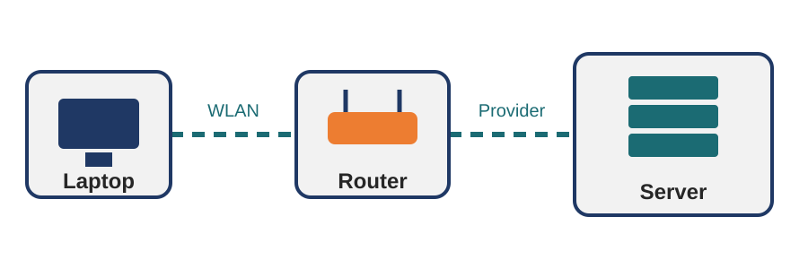

<!-- .slide: class="titel" -->
# Musterpräsentation

Alle Folienlayouts auf einen Blick

Vorlage zum Kopieren für neue Lektionen

Note:
Diese Präsentation zeigt alle Layouts. Kopiere die Datei, wenn du eine neue Lektion von Hand schreiben willst.

Die Lektionsnummer im orangen Kreis kommt aus der kapitel.json.

---

## Normale Folie mit Liste

- Folien werden mit drei Bindestrichen auf einer eigenen Zeile getrennt
- Text mit **fett** und *kursiv*
- Unterpunkte mit zwei Leerzeichen Einzug
  - zum Beispiel so
  - oder so
- Sprechernotizen beginnen mit «Note:»

Note:
Alles nach «Note:» sieht nur die Lehrperson in der Referentenansicht (Taste S).

---

<!-- .slide: data-zeit="3" -->
## Folie mit Zeitbadge und Hinweis

Ein Zeitbadge oben rechts entsteht mit `data-zeit="3"` in der Folienzeile.

Mit der Taste **T** startet der Countdown.

> Ein Zitat mit «>» wird zum Hinweiskasten unten auf der Folie.

---

## Tabelle

| Gerät | Aufgabe | Beispiel |
|---|---|---|
| Router | verbindet das Heimnetz mit dem Internet | WLAN-Router zu Hause |
| Provider | stellt den Zugang zum Internet bereit | Swisscom, Sunrise, Salt |
| Server | stellt Daten und Dienste bereit | YouTube, Schulwebsite |

---

## Bild

---

<!-- .slide: class="spalten" -->
## Zwei Spalten: Text und Bild

- Links steht der Text
- Rechts steht das Bild
- Mit einer Linie aus drei Sternchen kannst du selbst bestimmen, wo die zweite Spalte beginnt

---

<!-- .slide: class="auftrag" -->
## Bewertungen prüfen

- Zeit: 7'
- Sozialform: Partnerarbeit
- Material: Laptop, Arbeitsblatt
- Arbeitsbuch: S. 14 und 15

1. Lest die drei Bewertungen auf dem Arbeitsblatt.
2. Markiert Hinweise, dass eine Bewertung gefälscht sein könnte.
3. Entscheidet: Welcher Bewertung vertraut ihr am meisten? Begründet.

> Wer fertig ist: Sucht selbst eine Bewertung im Internet und prüft sie.

Note:
Die Seitenleiste entsteht aus der ersten Liste mit «Zeit:», «Sozialform:», «Material:» und «Arbeitsbuch:».
Die Zeit wird zum Zeitbadge und zur Dauer des Countdowns (Taste T).

---

<!-- .slide: class="loesung" -->
## Lösung: Bewertungen prüfen

| Bewertung | vertrauenswürdig? | Grund |
|---|---|---|
| A | eher nein | nur Lob, keine Details, viele Ausrufezeichen |
| B | ja | beschreibt Vor- und Nachteile genau |
| C | eher nein | am selben Tag wie 50 andere 5-Sterne-Bewertungen |

---

<!-- .slide: class="karten" -->
## Drei Begriffe

### Router
Verbindet die Geräte zu Hause und leitet die Daten ins Internet weiter.

### Provider
Firma, die uns den Zugang zum Internet verkauft.

### Server
Computer, der Daten speichert und auf Anfrage verschickt.

---

<!-- .slide: class="merke" -->
## Das Internet ist ein Netz aus Netzen

Daten reisen in kleinen **Paketen** über viele Router bis zum Ziel.
